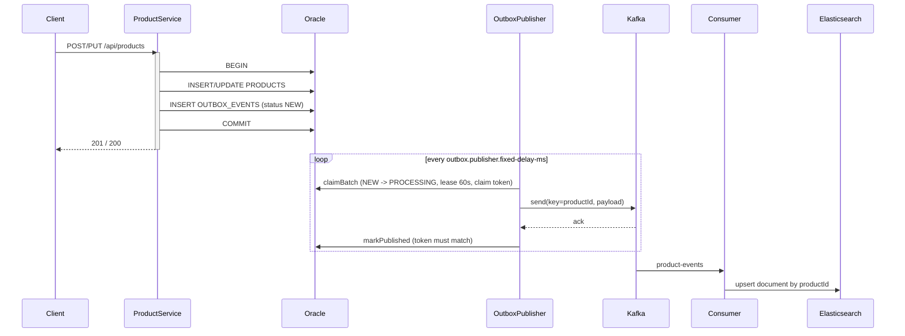
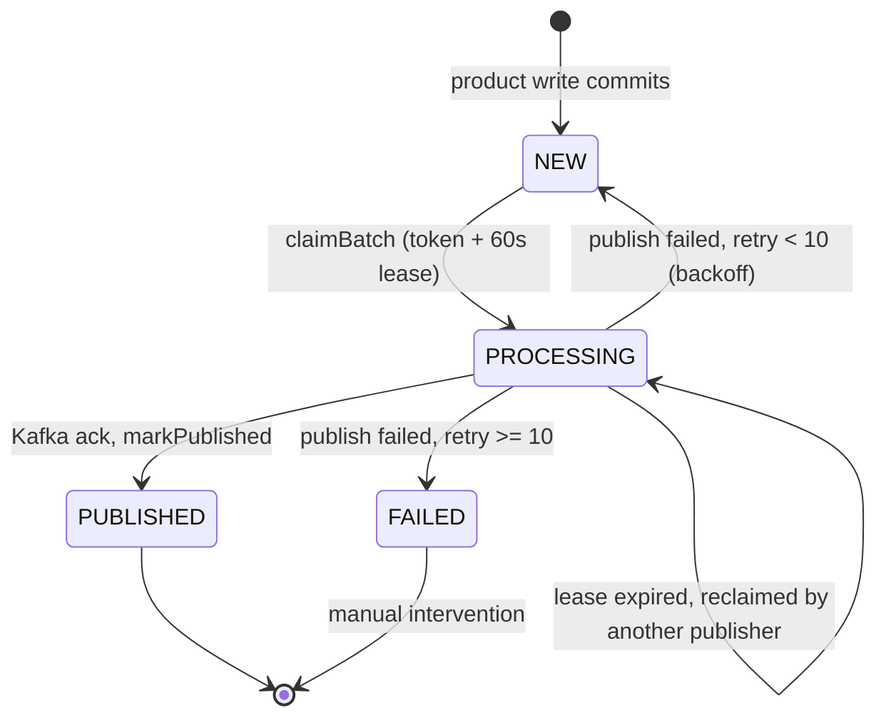
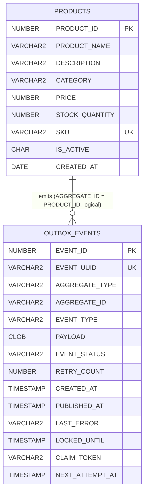

# Architecture

This document describes the problem the Flipkart-style product search service solves, the design patterns it uses, its runtime architecture, and its database schema.

## Contents

1. [Problem statement](#1-problem-statement)
2. [Goals and non-goals](#2-goals-and-non-goals)
3. [System architecture](#3-system-architecture)
4. [Design patterns used](#4-design-patterns-used)
5. [Database tables and schema](#5-database-tables-and-schema)
6. [Event contract](#6-event-contract)
7. [Elasticsearch document](#7-elasticsearch-document)
8. [Observability](#8-observability)
9. [Failure modes and recovery](#9-failure-modes-and-recovery)
10. [Known gaps and roadmap](#10-known-gaps-and-roadmap)

---

## 1. Problem statement

An e-commerce catalogue (Flipkart-style) needs two things that no single datastore does well at the same time:

| Need | Best fit |
|---|---|
| Correct, transactional product data (price, stock, SKU uniqueness) | Relational database (Oracle) |
| Fast full-text search with typo tolerance, filters, sorting and paging over many products | Search engine (Elasticsearch) |

Keeping both in step creates the classic **dual-write problem**:

- If the service writes Oracle and then Elasticsearch/Kafka directly, a crash between the two leaves them inconsistent (the product exists but is not searchable, or the reverse).
- If it publishes to Kafka *before* the Oracle commit and the transaction then rolls back, consumers see a change that never happened.
- Search traffic is typically orders of magnitude higher than write traffic, so reads must not load the transactional database.

**The service must therefore:**

1. Treat Oracle as the single source of truth for products.
2. Make every committed product change reliably reach Elasticsearch, even if Kafka, Elasticsearch or the application is down at that moment (eventual consistency, no lost updates).
3. Serve search from Elasticsearch (and cache hot results in Redis) without touching Oracle.
4. Be observable: metrics, structured logs, health probes and documented APIs.

## 2. Goals and non-goals

**Goals**

- No lost events: a committed product change always results in exactly one outbox row.
- At-least-once delivery to Kafka, with idempotent consumers.
- Horizontally scalable publisher (multiple instances never claim the same event).
- Fast, typo-tolerant, filterable, paginated search.
- Operable: Prometheus/Grafana metrics, JSON logs in Elasticsearch/Kibana, Swagger UI, k6 load tests.

**Non-goals (currently)**

- Strong consistency between Oracle and the search index (search is eventually consistent).
- Capturing changes made by other writers that bypass this service (would need CDC/Debezium).
- Authentication/authorisation (not implemented yet).

## 3. System architecture

```mermaid
flowchart LR
    Client([Client / Postman / k6]) -->|REST| API

    subgraph App[Spring Boot application :8085]
        API[Controllers<br/>ProductController<br/>ProductSearchController]
        SVC[ProductService<br/>@Transactional]
        SEARCH[ProductSearchService]
        OUTREPO[OutboxRepository]
        PUB[OutboxPublisher<br/>@Scheduled]
        CON[ProductEventConsumer<br/>@KafkaListener]
        ACT[Actuator /actuator/prometheus]
        API --> SVC
        API --> SEARCH
        SVC --> OUTREPO
        PUB --> OUTREPO
    end

    SVC -->|1. same transaction| ORA[(Oracle<br/>PRODUCTS + OUTBOX_EVENTS)]
    PUB -->|2. claim NEW rows<br/>FOR UPDATE SKIP LOCKED| ORA
    PUB -->|3. publish| K[(Kafka<br/>product-events)]
    K -->|4. consume| CON
    CON -->|5. upsert| ES[(Elasticsearch<br/>products index)]
    SEARCH -->|query| ES
    SEARCH -. cache .-> R[(Redis)]

    ACT -->|scrape 5s| PROM[Prometheus :9090]
    PROM --> GRAF[Grafana :3000]
    App -->|JSON logs TCP :5000| LS[Logstash]
    LS --> ES
    ES --> KIB[Kibana :5601]
    KUI[Kafka UI :8081] -.-> K
```

### Write path (create / update product)



### Read path (search)

`GET /api/products/search` builds a bool query (fuzzy `match` on `productName`, `term` filter on `category`, `range` on `price`, `term` on `isActive`), applies sorting and paging, and queries Elasticsearch only. Oracle is never touched on the read path.

### Data ownership

| Component | Role | Source of truth |
|---|---|---|
| Oracle `PRODUCTS` | Authoritative product records | **Yes** |
| Oracle `OUTBOX_EVENTS` | Durable delivery ledger | Delivery state only |
| Kafka `product-events` | Transport of change events | No |
| Elasticsearch `products` | Search projection | No (rebuildable) |
| Redis | Cache | No |

## 4. Design patterns used

| Pattern | Where | Why |
|---|---|---|
| **Transactional Outbox** | `ProductService` + `OutboxRepository` (`OUTBOX_EVENTS`) | Solves the dual-write problem: product change and event are committed atomically in Oracle. |
| **Polling Publisher** | `OutboxPublisher` (`@Scheduled`) | Moves committed outbox rows to Kafka outside the business transaction. |
| **Competing consumers / row claiming** | `OutboxRepository.claimBatch` (`FOR UPDATE SKIP LOCKED`) | Multiple app instances can publish concurrently without double-claiming. |
| **Lease + claim token (optimistic fencing)** | `LOCKED_UNTIL`, `CLAIM_TOKEN` | A crashed publisher's rows are reclaimed after the lease expires; a stale publisher cannot mark a row it no longer owns. |
| **Retry with exponential backoff + dead state** | `recordFailure`, `RETRY_COUNT`, `NEXT_ATTEMPT_AT`, status `FAILED` | Delays retries (1s, 2s, 4s ... max 300s) and stops after 10 attempts. |
| **Event-Carried State Transfer** | `ProductChangedEvent` (full product snapshot) | Consumers need no call-back to Oracle. |
| **CQRS (lightweight)** | Oracle (write model) vs Elasticsearch (read model) | Independent scaling and modelling of reads and writes. |
| **Idempotent consumer** (target design) | Stable ES `_id` = product ID; `eventUuid` available | Outbox delivery is at-least-once, so duplicates must be harmless. |
| **Cache-Aside** | Spring Cache + Redis (`@EnableCaching`) | Offload hot search results. |
| **Repository** | `OutboxRepository`, `ProductSearchRepository` | Isolates persistence details from services. |
| **DTO / Record** | `ProductRequest`, `ProductResponse`, `ErrorResponse`, ... | Immutable, explicit API contracts decoupled from storage models. |
| **Mapper** | `ProductMapper` | Keeps document-to-response conversion in one place. |
| **Centralised exception handling (Controller Advice)** | `GlobalExceptionHandler` | One consistent `ErrorResponse` shape and status mapping. |
| **Constructor injection / DI** | Lombok `@RequiredArgsConstructor` | Explicit, testable dependencies. |
| **Externalised configuration (12-factor)** | `application.properties` `${ENV:default}` + `.env` | Same artifact runs everywhere; secrets stay outside code. |
| **Multi-stage build / least privilege** | `Dockerfile` | Small runtime image, non-root user (uid 10001). |
| **Observability (metrics, logs, health)** | Actuator, Micrometer, Prometheus, Grafana, Logstash | Operate and debug the system in production. |

### Exception to HTTP mapping

| Exception | HTTP status |
|---|---|
| `MethodArgumentNotValidException` | 400 (with `validationErrors`) |
| `IllegalArgumentException` | 400 |
| `ProductNotFoundException` | 404 |
| `DuplicateKeyException` | 409 |
| `ProductSearchException` | 500 |
| `DataAccessException` | 503 |

All responses use the `ErrorResponse` record: `timestamp, status, error, message, path, validationErrors`.

## 5. Database tables and schema

Oracle is the system of record. Schema owner: `PRATIK`.

### 5.1 `PRODUCTS`

```sql
create table PRODUCTS
(
    PRODUCT_ID     NUMBER                 not null
        primary key,
    PRODUCT_NAME   VARCHAR2(150)          not null,
    DESCRIPTION    VARCHAR2(500),
    CATEGORY       VARCHAR2(100),
    PRICE          NUMBER(10, 2)          not null
        constraint CHK_PRODUCTS_PRICE
            check (price >= 0),
    STOCK_QUANTITY NUMBER default 0       not null
        constraint CHK_PRODUCTS_STOCK
            check (stock_quantity >= 0),
    SKU            VARCHAR2(50)           not null
        unique,
    IS_ACTIVE      CHAR   default 'Y'     not null
        constraint CHK_PRODUCTS_ACTIVE
            check (is_active IN ('Y', 'N')),
    CREATED_AT     DATE   default SYSDATE not null
);

create index IDX_PRODUCTS_CATEGORY       on PRODUCTS (CATEGORY);
create index IDX_PRODUCTS_NAME_UPPER     on PRODUCTS (UPPER("PRODUCT_NAME"));
create index IDX_PRODUCTS_CATEGORY_PRICE on PRODUCTS (CATEGORY, PRICE);
```

| Column | Type | Constraints / notes |
|---|---|---|
| `PRODUCT_ID` | `NUMBER` | PK; generated from `PRODUCTS_SEQ.NEXTVAL` by the application |
| `PRODUCT_NAME` | `VARCHAR2(150)` | not null |
| `DESCRIPTION` | `VARCHAR2(500)` | optional |
| `CATEGORY` | `VARCHAR2(100)` | optional, free text |
| `PRICE` | `NUMBER(10,2)` | not null, `>= 0` |
| `STOCK_QUANTITY` | `NUMBER` | default 0, `>= 0` |
| `SKU` | `VARCHAR2(50)` | not null, **unique** |
| `IS_ACTIVE` | `CHAR` | `'Y'` / `'N'`, default `'Y'` |
| `CREATED_AT` | `DATE` | default `SYSDATE` |

Sequence used by the application: `PRODUCTS_SEQ`.

### 5.2 `OUTBOX_EVENTS`

```sql
create table OUTBOX_EVENTS
(
    EVENT_ID        NUMBER                            not null
        constraint PK_OUTBOX_EVENTS
            primary key,
    EVENT_UUID      VARCHAR2(36)                      not null
        constraint UK_OUTBOX_EVENT_UUID
            unique,
    AGGREGATE_TYPE  VARCHAR2(100)                     not null,
    AGGREGATE_ID    VARCHAR2(100)                     not null,
    EVENT_TYPE      VARCHAR2(100)                     not null,
    PAYLOAD         CLOB                              not null,
    EVENT_STATUS    VARCHAR2(20) default 'NEW'        not null
        constraint CK_OUTBOX_EVENT_STATUS
            check (EVENT_STATUS IN ('NEW', 'PROCESSING', 'PUBLISHED', 'FAILED')),
    RETRY_COUNT     NUMBER       default 0            not null,
    CREATED_AT      TIMESTAMP(6) default SYSTIMESTAMP not null,
    PUBLISHED_AT    TIMESTAMP(6),
    LAST_ERROR      VARCHAR2(2000),
    LOCKED_UNTIL    TIMESTAMP(6),
    CLAIM_TOKEN     VARCHAR2(36),
    NEXT_ATTEMPT_AT TIMESTAMP(6)
);

create index IDX_OUTBOX_STATUS_CREATED on OUTBOX_EVENTS (EVENT_STATUS, CREATED_AT);
```

Sequence used by the application: `OUTBOX_EVENTS_SEQ`.

| Column | Purpose |
|---|---|
| `EVENT_ID` | Numeric PK (from `OUTBOX_EVENTS_SEQ`) |
| `EVENT_UUID` | Globally unique event ID, used for tracing and deduplication |
| `AGGREGATE_TYPE` | Entity type, currently `PRODUCT` |
| `AGGREGATE_ID` | Product ID as text; used as the Kafka message key |
| `EVENT_TYPE` | `PRODUCT_CREATED`, `PRODUCT_UPDATED` |
| `PAYLOAD` | JSON snapshot of the product at the time of the change |
| `EVENT_STATUS` | State machine, see below |
| `RETRY_COUNT` | Failed publish attempts so far |
| `CREATED_AT` / `PUBLISHED_AT` | When the event was recorded / acknowledged by Kafka |
| `LAST_ERROR` | Most recent publish error (truncated to 2000) |
| `LOCKED_UNTIL` | Lease expiry for a `PROCESSING` row |
| `CLAIM_TOKEN` | Random token proving which publisher owns the claim |
| `NEXT_ATTEMPT_AT` | Earliest time a failed row may be retried (backoff) |

### 5.3 Outbox state machine



### 5.4 Entity relationship



The relationship is logical only: there is deliberately no foreign key, so outbox rows survive product changes and can be archived independently.

## 6. Event contract

Topic: `product-events` (key = product ID, 3 partitions locally). Payload (`ProductChangedEvent`, JSON):

| Field | Type | Description |
|---|---|---|
| `eventId` | string (UUID) | Same as `OUTBOX_EVENTS.EVENT_UUID` |
| `productId` | number | Aggregate ID |
| `eventType` | string | `PRODUCT_CREATED` or `PRODUCT_UPDATED` |
| `productName`, `description`, `category` | string | Product snapshot |
| `price` | decimal | Product snapshot |
| `stockQuantity` | integer | Product snapshot |
| `sku` | string | Product snapshot |
| `active` | boolean | `IS_ACTIVE = 'Y'` |
| `occurredAt` | ISO-8601 instant | Event creation time |

## 7. Elasticsearch document

Index `products` (`ProductDocument`):

| Field | ES type |
|---|---|
| `id` (document `_id`) | keyword (stable per product) |
| `productId` | long |
| `productName` | text |
| `description` | text |
| `category` | keyword |
| `price` | inferred numeric |
| `stockQuantity` | inferred numeric |
| `sku` | keyword |
| `isActive` | boolean |

## 8. Observability

| Concern | Tooling | Entry point |
|---|---|---|
| Metrics | Spring Boot Actuator + Micrometer + Prometheus | `/actuator/prometheus` |
| Dashboards | Grafana (auto-provisioned) | http://localhost:3000 |
| Logs | Logback JSON encoder, Logstash, Elasticsearch, Kibana | index `product-search-logs-*` |
| Health | Actuator liveness / readiness probes | `/actuator/health/liveness`, `/actuator/health/readiness` |
| API docs | springdoc-openapi | `/swagger-ui.html`, `/v3/api-docs` |
| Load testing | k6 | `k6/` |

Custom business metrics: `outbox.events.published`, `outbox.events.failed`, `outbox.publish.duration` (histogram).

## 9. Failure modes and recovery

| Failure | Behaviour |
|---|---|
| Kafka down | Product writes still succeed; outbox rows stay `NEW`/retry with backoff, then publish when Kafka returns. |
| App crashes after Kafka ack, before `markPublished` | Row is reclaimed after the 60 s lease and sent again (duplicate) - consumer must be idempotent. |
| App crashes while a row is `PROCESSING` | Lease expires, another instance reclaims it. |
| Two publishers race | `SKIP LOCKED` + claim token: only one wins; the other's `markPublished` fails the token check. |
| Elasticsearch down | Search returns 500/503; events accumulate in Kafka and are applied when the consumer recovers. |
| Redis down | Cache misses only (once cache errors are handled gracefully). |
| Logstash down | Application keeps running; the TCP appender reconnects automatically. |
| 10 consecutive publish failures | Row becomes `FAILED` and needs manual replay (reset to `NEW`). |

## 10. Known gaps and roadmap

Items found during review that are **not yet implemented or fixed**:

- `ProductEventConsumer` currently only logs; Oracle-to-Elasticsearch indexing is not implemented yet.
- `OutboxRepository.claimBatch`: SQL operator precedence (`A OR B AND ROWNUM <= ?`) means the batch limit only applies to the `PROCESSING` branch; add parentheses and an `ORDER BY EVENT_ID`.
- No product `VERSION`/`UPDATED_AT`, so stale events cannot be rejected by the consumer.
- `ProductService.updateProduct`: a duplicate-SKU `DuplicateKeyException` raised by the `UPDATE` itself is not caught (only the outbox insert is wrapped); the global handler still maps it to 409.
- `@EnableCaching` is on but no `@Cacheable` methods exist yet.
- `ProductRequest` has no Bean Validation annotations (validation is hand-written in the service).
- Add Flyway migrations, Testcontainers integration tests, authentication, and an outbox clean-up job.
