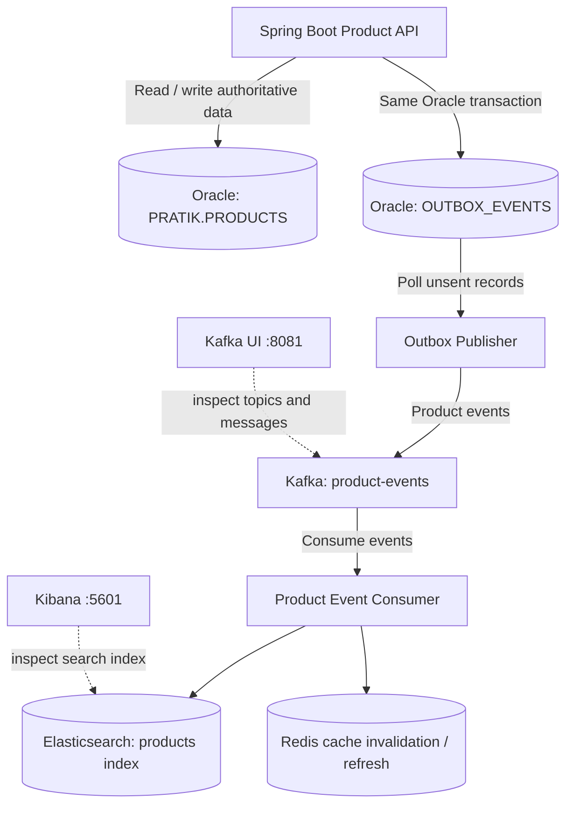
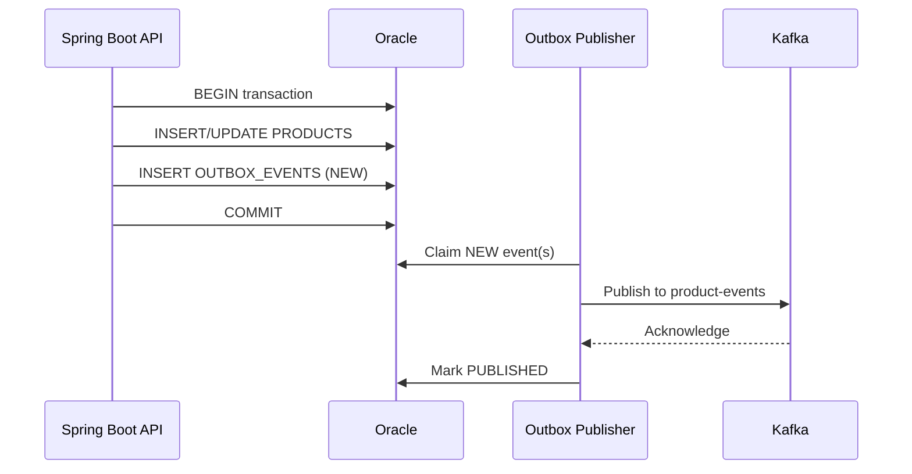

# Flipkart-Style Product Search

A local product-search backend built with **Java 21, Spring Boot, Oracle, Elasticsearch, Redis, and Kafka**. Kafka UI provides a browser interface for inspecting Kafka topics and messages.

> See **[ARCHITECTURE.md](ARCHITECTURE.md)** for the problem statement, design patterns, database schema and failure modes.

> **Architecture principle:** Oracle is the source of truth. Elasticsearch is a search-optimized projection, Redis is a cache, and Kafka transports product-change events. The Transactional Outbox Pattern reliably records events in the same Oracle transaction as product changes.

## Table of contents

- [Architecture](#architecture)
- [Technology stack](#technology-stack)
- [Prerequisites](#prerequisites)
- [Local services](#local-services)
- [Start and stop the infrastructure](#start-and-stop-the-infrastructure)
- [Oracle configuration](#oracle-configuration)
- [Oracle product and outbox schemas](#oracle-product-and-outbox-schemas)
- [Spring Boot configuration](#spring-boot-configuration)
- [Transactional Outbox Pattern](#transactional-outbox-pattern)
- [Kafka topic and Kafka UI](#kafka-topic-and-kafka-ui)
- [End-to-end event flow](#end-to-end-event-flow)
- [Testing and verification](#testing-and-verification)
- [Reliability and production considerations](#reliability-and-production-considerations)
- [Troubleshooting](#troubleshooting)
- [Suggested project structure](#suggested-project-structure)
- [Quick start](#quick-start)
- [Configuration with .env](#configuration-with-env)
- [API documentation (OpenAPI / Swagger UI)](#api-documentation-openapi--swagger-ui)
- [Docker image (multi-stage, non-root)](#docker-image-multi-stage-non-root)
- [Load testing with k6](#load-testing-with-k6)
- [Postman collection](#postman-collection)

## Architecture



### Data ownership

| Component | Responsibility | Source of truth? |
|---|---|---|
| Oracle `PRATIK.PRODUCTS` | Authoritative product records | **Yes** |
| Oracle `OUTBOX_EVENTS` | Durable records of events to publish | Event delivery ledger |
| Kafka `product-events` | Distributes product-change events | No |
| Elasticsearch `products` index | Full-text, fuzzy, filtered and paginated search | No |
| Redis | Cache for frequently requested data/results | No |
| Kafka UI | Inspect Kafka cluster, topics and messages | No |
| Kibana | Inspect and query Elasticsearch | No |

## Technology stack

- Java 21
- Spring Boot (project currently uses Spring Boot 4.1.2)
- Maven Wrapper
- Oracle Database / Oracle JDBC driver
- Spring JDBC (`JdbcTemplate`) and Spring transactions
- Elasticsearch 9.4.8 and Kibana 9.4.8
- Spring Data Elasticsearch / Elasticsearch Java client (match dependency versions to the project)
- Redis
- Kafka 4.1.1
- Kafka UI
- Jackson for JSON event payload serialization

Check `pom.xml` and `compose.yaml` for the exact versions actually configured in the checkout. Keep Elasticsearch and Kibana on compatible versions.

## Prerequisites

- Windows with PowerShell
- Java 21
- Docker Desktop with Docker Compose
- Maven Wrapper (`mvnw.cmd`)
- An Oracle instance reachable from the host (for example, a local Oracle installation)
- Oracle SQL Developer or another SQL client
- IntelliJ IDEA (optional)

## Local services

The current local Docker setup uses the following service/container names and ports:

| Service | Container name | Host port | URL / connection |
|---|---|---:|---|
| Elasticsearch | `product-search-es` | `9200` | `http://localhost:9200` |
| Kibana | `product-search-kibana` | `5601` | `http://localhost:5601` |
| Redis | `product-search-redis` | `6379` | `localhost:6379` |
| Kafka | `product-search-kafka` | `9092` | `localhost:9092` |
| Kafka internal listener | Kafka container | `29092` | `kafka:29092` from Docker network |
| Kafka UI | `product-search-kafka-ui` | `8081` | `http://localhost:8081` |

The internal Kafka listener is intended for other containers. Host-run Spring Boot uses `localhost:9092`; Kafka UI uses `kafka:29092`.

## Start and stop the infrastructure

Run these commands from the folder containing your Docker Compose file.

```powershell
# Start services in the background
docker compose up -d

# Check service status
docker compose ps

# Follow logs
docker compose logs -f kafka
docker compose logs -f elasticsearch
docker compose logs -f redis

# Stop services but keep persisted volumes
docker compose down

# Stop and remove volumes (DESTRUCTIVE: deletes persisted local service data)
docker compose down -v
```

Do not use `docker compose down -v` unless you deliberately want to delete the volumes for Elasticsearch/Kafka/other services.

### Quick connectivity checks

```powershell
# Elasticsearch
Invoke-RestMethod http://localhost:9200

# Redis (if redis-cli is installed in the container)
docker exec product-search-redis redis-cli ping

# Kafka topic list
docker exec product-search-kafka /opt/kafka/bin/kafka-topics.sh `
  --bootstrap-server localhost:9092 --list
```

Expected Redis response: `PONG`. Elasticsearch should return JSON describing the cluster.

## Oracle configuration

Oracle is installed/reachable separately from the Docker services in this setup. The actual JDBC service name depends on your Oracle installation; do not assume it is `XEPDB1`.

Set connection details in the PowerShell session before starting Spring Boot:

```powershell
$env:ORACLE_DB_URL = "jdbc:oracle:thin:@//localhost:1521/YOUR_SERVICE_NAME"
$env:ORACLE_DB_USERNAME = "PRATIK"
$env:ORACLE_DB_PASSWORD = "YOUR_PASSWORD"
```

Replace `YOUR_SERVICE_NAME` and `YOUR_PASSWORD` with your actual values. Do not commit credentials to Git. For persistent local development put them in the untracked `.env` file (see [Configuration with .env](#configuration-with-env)).

Recommended `application.properties` entries:

```properties
spring.datasource.url=${ORACLE_DB_URL:jdbc:oracle:thin:@localhost:1521:xe}
spring.datasource.username=${ORACLE_DB_USERNAME:pratik}
spring.datasource.password=${ORACLE_DB_PASSWORD:root}
spring.datasource.driver-class-name=oracle.jdbc.OracleDriver

spring.datasource.hikari.maximum-pool-size=10
spring.datasource.hikari.minimum-idle=2
```

Example dependencies (check `pom.xml` to avoid duplicates; let Spring Boot manage versions):

```xml
<dependency>
    <groupId>org.springframework.boot</groupId>
    <artifactId>spring-boot-starter-jdbc</artifactId>
</dependency>

<dependency>
    <groupId>com.oracle.database.jdbc</groupId>
    <artifactId>ojdbc11</artifactId>
    <scope>runtime</scope>
</dependency>
```

Jackson is used to serialize event records to JSON. Ensure a compatible Jackson dependency/starter is on the classpath and that the application has an `ObjectMapper` bean. The project currently includes a manual `JacksonConfig` bean; avoid registering multiple conflicting `ObjectMapper` beans if you later enable Boot auto-configuration.

## Oracle product and outbox schemas

### Existing product table

The existing source table is `PRATIK.PRODUCTS`. The columns observed in the current project context include:

| Column | Type | Notes |
|---|---|---|
| `PRODUCT_ID` | `NUMBER` | Verify actual primary-key/unique constraints before relying on it |
| `PRODUCT_NAME` | `VARCHAR2(150)` | Not null |
| `DESCRIPTION` | `VARCHAR2(500)` | Nullable |
| `CATEGORY` | `VARCHAR2(100)` | Nullable |
| `PRICE` | `NUMBER(10,2)` | Not null |
| `STOCK_QUANTITY` | `NUMBER` | Default `0`, not null |
| `SKU` | `VARCHAR2(50)` | Not null; verify uniqueness constraint |
| `IS_ACTIVE` | `CHAR(1)` | Default `'Y'`, not null |
| `CREATED_AT` | `DATE` | Default `SYSDATE`, not null |

The source table may contain additional columns. Check the actual Oracle schema before writing SQL or mapping every column.

### Outbox table

Run this once as the `PRATIK` schema owner (or adapt schema/permissions if using another user). If the objects already exist, do not run the `CREATE` statements again.

```sql
CREATE TABLE OUTBOX_EVENTS (
    EVENT_ID       NUMBER         NOT NULL,
    EVENT_UUID     VARCHAR2(36)   NOT NULL,
    AGGREGATE_TYPE VARCHAR2(100)  NOT NULL,
    AGGREGATE_ID   VARCHAR2(100)  NOT NULL,
    EVENT_TYPE     VARCHAR2(100)  NOT NULL,
    PAYLOAD        CLOB           NOT NULL,
    EVENT_STATUS   VARCHAR2(20)   DEFAULT 'NEW' NOT NULL,
    RETRY_COUNT    NUMBER         DEFAULT 0 NOT NULL,
    CREATED_AT     TIMESTAMP      DEFAULT SYSTIMESTAMP NOT NULL,
    PUBLISHED_AT   TIMESTAMP,
    LAST_ERROR     VARCHAR2(2000),

    CONSTRAINT PK_OUTBOX_EVENTS PRIMARY KEY (EVENT_ID),
    CONSTRAINT UK_OUTBOX_EVENT_UUID UNIQUE (EVENT_UUID),
    CONSTRAINT CK_OUTBOX_EVENT_STATUS
        CHECK (EVENT_STATUS IN ('NEW', 'PROCESSING', 'PUBLISHED', 'FAILED'))
);

CREATE SEQUENCE OUTBOX_EVENTS_SEQ
    START WITH 1
    INCREMENT BY 1
    NOCACHE;

CREATE INDEX IDX_OUTBOX_STATUS_CREATED
    ON OUTBOX_EVENTS (EVENT_STATUS, CREATED_AT);
```

#### Outbox column reference

| Column | Purpose |
|---|---|
| `EVENT_ID` | Numeric database primary key |
| `EVENT_UUID` | Unique ID for tracing/deduplication |
| `AGGREGATE_TYPE` | Entity type, currently `PRODUCT` |
| `AGGREGATE_ID` | Product identifier serialized as text |
| `EVENT_TYPE` | For example, `PRODUCT_CREATED` or `PRODUCT_UPDATED` |
| `PAYLOAD` | JSON snapshot of the product event |
| `EVENT_STATUS` | `NEW`, `PROCESSING`, `PUBLISHED`, or `FAILED` |
| `RETRY_COUNT` | Number of publication retries/attempts, as implemented by publisher |
| `CREATED_AT` | Time the event was recorded |
| `PUBLISHED_AT` | Time Kafka acknowledged publication and the publisher marked it |
| `LAST_ERROR` | Most recent publication error, if any |

Verify the objects:

```sql
SELECT table_name
FROM user_tables
WHERE table_name = 'OUTBOX_EVENTS';

SELECT sequence_name
FROM user_sequences
WHERE sequence_name = 'OUTBOX_EVENTS_SEQ';

SELECT column_name, data_type, nullable
FROM user_tab_columns
WHERE table_name = 'OUTBOX_EVENTS'
ORDER BY column_id;
```

Verify the primary key of the existing product table:

```sql
SELECT cols.column_name, cons.constraint_name
FROM user_constraints cons
JOIN user_cons_columns cols
  ON cons.constraint_name = cols.constraint_name
WHERE cons.table_name = 'PRODUCTS'
  AND cons.constraint_type = 'P';
```

## Spring Boot configuration

The following are the key local properties used in this project. Merge them with the existing file rather than replacing unrelated settings.

```properties
# Redis
spring.data.redis.host=localhost
spring.data.redis.port=6379
spring.data.redis.connect-timeout=2s
spring.data.redis.timeout=2s
spring.cache.type=redis
spring.cache.redis.time-to-live=5m
spring.cache.redis.cache-null-values=false

# Kafka (host-run Spring Boot application)
spring.kafka.bootstrap-servers=localhost:9092
spring.kafka.producer.key-serializer=org.apache.kafka.common.serialization.StringSerializer
spring.kafka.producer.value-serializer=org.apache.kafka.common.serialization.StringSerializer
spring.kafka.consumer.group-id=product-search-sync
spring.kafka.consumer.auto-offset-reset=earliest
spring.kafka.consumer.key-deserializer=org.apache.kafka.common.serialization.StringDeserializer
spring.kafka.consumer.value-deserializer=org.apache.kafka.common.serialization.StringDeserializer

# Oracle (environment variables)
spring.datasource.url=${ORACLE_DB_URL:jdbc:oracle:thin:@localhost:1521:xe}
spring.datasource.username=${ORACLE_DB_USERNAME:pratik}
spring.datasource.password=${ORACLE_DB_PASSWORD:root}
spring.datasource.driver-class-name=oracle.jdbc.OracleDriver
```

The application main class uses `@SpringBootApplication`. Redis caching is enabled using `@EnableCaching` if cache annotations such as `@Cacheable` are being used.

For the string-based Kafka smoke test, key/value serializers and deserializers should remain strings. If switching to JSON Kafka messages, configure JSON serializers/deserializers consistently and validate payload types.

## Transactional Outbox Pattern

### The problem it solves

Updating Oracle and publishing to Kafka are two independent operations. If Oracle commits but Kafka is unavailable, a direct publish-after-update approach can lose the event. If Kafka is published first and the Oracle transaction rolls back, Kafka can contain an event for a change that never committed.

### The solution

Within one Oracle transaction:

1. Update or insert the product in `PRODUCTS`.
2. Insert a corresponding JSON event into `OUTBOX_EVENTS`.
3. Commit both together—or roll back both if either write fails.

A separate publisher reads committed outbox rows and publishes them to Kafka.



### Transactional service rule

The product write and outbox insert must share the same transaction manager and database connection. With Spring JDBC, a `@Transactional` service method that calls both JDBC operations normally provides this when they use the same configured datasource.

```java
@Transactional
public void updateProduct(/* validated product input */) {
    // 1. Update the existing PRODUCTS row with JdbcTemplate.
    // 2. Ensure exactly one row was updated.
    // 3. Build a ProductChangedEvent with a unique event ID.
    // 4. Insert the serialized event via OutboxRepository.
    // Do not publish to Kafka in this transaction.
}
```

Do not swallow exceptions from the outbox insert. Let failures propagate so the transaction can roll back. Ensure the product SQL uses the actual primary key and column names from Oracle.

### Outbox publisher requirements

The publisher is a separate component and should:

1. Claim a batch of `NEW` events safely (e.g. Oracle `FOR UPDATE SKIP LOCKED` with a defined claim/lease strategy).
2. Commit the claim in a short transaction before waiting for Kafka.
3. Publish the JSON payload to `product-events`, preferably with `AGGREGATE_ID` as the Kafka key.
4. Mark the row `PUBLISHED` only after the Kafka send future reports success.
5. Increment retry count and save error details on failures.
6. Recover abandoned `PROCESSING` rows after a crash using a lease/timeout strategy.
7. Apply backoff and monitoring for repeated failures.

The outbox schema above supports these states, but the polling/claim/recovery logic must be implemented in the application. Merely creating the table does not publish events automatically.

### Delivery semantics and idempotency

The outbox pattern is generally **at-least-once delivery**. A publisher can send to Kafka successfully and crash before marking the Oracle row as published. That event can be sent again after restart.

Therefore:

- Include a stable `eventId` in every event.
- Make the consumer idempotent.
- Use a stable Elasticsearch document ID based on product ID so repeated upserts overwrite the same document.
- Consider storing processed event IDs or comparing event versions if duplicate/stale events could otherwise cause incorrect results.
- If multiple app instances run, use a safe row-claim strategy; do not let them freely publish the same `NEW` rows.
- If other applications or scripts also modify Oracle products, application-level outbox writes will not capture those changes. Consider Oracle CDC/Debezium or database-level enforcement for multi-writer environments.

## Kafka topic and Kafka UI

### Topic

Recommended local topic:

- Topic name: `product-events`
- Partitions: `3`
- Replication factor: `1` (appropriate for a single-broker local development setup, not production high availability)

Create it using Kafka UI at `http://localhost:8081` or PowerShell:

```powershell
docker exec product-search-kafka /opt/kafka/bin/kafka-topics.sh `
  --bootstrap-server localhost:9092 `
  --create --if-not-exists `
  --topic product-events `
  --partitions 3 `
  --replication-factor 1
```

List topics:

```powershell
docker exec product-search-kafka /opt/kafka/bin/kafka-topics.sh `
  --bootstrap-server localhost:9092 --list
```

### Kafka UI

Open `http://localhost:8081`, select cluster `product-search-local`, then use **Topics** to inspect `product-events`, partitions, offsets, and messages.

The Kafka UI container connects to Kafka using the Docker network address `kafka:29092`. The Spring Boot application running on Windows connects through `localhost:9092`.

Current Kafka listener configuration should preserve the two endpoints:

```yaml
KAFKA_LISTENERS: PLAINTEXT://:9092,DOCKER://:29092,CONTROLLER://:9093
KAFKA_ADVERTISED_LISTENERS: PLAINTEXT://localhost:9092,DOCKER://kafka:29092
KAFKA_LISTENER_SECURITY_PROTOCOL_MAP: CONTROLLER:PLAINTEXT,PLAINTEXT:PLAINTEXT,DOCKER:PLAINTEXT
KAFKA_INTER_BROKER_LISTENER_NAME: DOCKER
KAFKA_CONTROLLER_LISTENER_NAMES: CONTROLLER
KAFKA_CONTROLLER_QUORUM_VOTERS: 1@localhost:9093
```

Kafka UI environment:

```yaml
KAFKA_CLUSTERS_0_NAME: product-search-local
KAFKA_CLUSTERS_0_BOOTSTRAPSERVERS: kafka:29092
```

Keep these settings consistent with the actual Compose file. After changing broker listener settings, recreate/restart the Kafka service as required by the Compose configuration.

## End-to-end event flow

1. A client creates or updates a product through the Spring Boot API.
2. Spring writes the product and an outbox event in one Oracle transaction.
3. The publisher claims the outbox event and sends it to Kafka.
4. Kafka acknowledges the message.
5. The publisher marks the outbox row `PUBLISHED`.
6. The consumer receives the event.
7. The consumer upserts the product document in Elasticsearch using the stable product ID.
8. The consumer invalidates or refreshes related Redis cache entries.
9. Search requests use Elasticsearch; Oracle remains authoritative for product records.

The API, publisher, consumer, Elasticsearch updater, and cache invalidation steps must all be implemented and tested. A topic and outbox table alone do not provide this complete flow.

## Testing and verification

### 1. Check Docker services

```powershell
docker compose ps
```

### 2. Check Oracle objects

```sql
SELECT COUNT(*) FROM PRODUCTS;
SELECT COUNT(*) FROM OUTBOX_EVENTS;
```

### 3. Check Kafka topic

```powershell
docker exec product-search-kafka /opt/kafka/bin/kafka-topics.sh `
  --bootstrap-server localhost:9092 --describe --topic product-events
```

### 4. Check Elasticsearch

```powershell
Invoke-RestMethod http://localhost:9200/products
```

The index may not exist until your application creates it or a document is indexed.

### 5. Check Redis

```powershell
docker exec product-search-redis redis-cli ping
```

Expected output: `PONG`.

### 6. Test rollback behavior

In a development-only test, deliberately cause the outbox insert to fail after the product update. Confirm that the product update is rolled back too. Use a disposable test record and restore any test constraints afterward.

### 7. Test Kafka outage and retry

1. Stop Kafka.
2. Update a product using the transactional API.
3. Confirm both the product update and outbox event commit in Oracle.
4. Confirm the event remains pending while Kafka is down.
5. Restart Kafka.
6. Confirm the publisher eventually sends the event and marks it published.

This test requires the outbox publisher and retry/recovery implementation to be present.

## Reliability and production considerations

- **Oracle remains authoritative:** never treat an Elasticsearch result or Redis cache value as the canonical product record.
- **Use event versions or timestamps:** a delayed older event must not overwrite a newer product state.
- **Idempotent consumer:** duplicate Kafka delivery should not create duplicate search documents or incorrect side effects.
- **Outbox cleanup:** define a retention policy and archive/delete old published rows after a safe period.
- **Retries and dead-letter handling:** use bounded retries, exponential backoff, alerts, and a deliberate recovery process for persistent failures.
- **Ordering:** use product ID as the Kafka message key so events for a given product normally route to the same partition. This does not by itself solve stale events from concurrent publishers; include versioning if strict per-product ordering matters.
- **Security:** use secrets/environment variables, restrict database privileges, and enable authentication/TLS when moving beyond local development.
- **High availability:** a single Kafka broker with replication factor 1 is for local development only.
- **Observability:** log event ID, product ID, topic, partition, offset, retry count, and failures. Monitor outbox backlog age and count.
- **Schema evolution:** version event payloads or otherwise plan compatibility as fields change.
- **External writers:** if changes can bypass the Spring service, the service-level outbox won't see those changes. Evaluate Oracle CDC/Debezium if needed.

## Quick start

```powershell
# 1. Infrastructure: Elasticsearch, Kibana, Redis, Kafka, Kafka UI
docker compose up -d

# 2. Application (from the project root so that .env is picked up)
.\mvnw.cmd spring-boot:run

# 3. Verify
Invoke-RestMethod http://localhost:8085/actuator/health
Start-Process http://localhost:8085/swagger-ui.html
```

| What | URL |
|---|---|
| Swagger UI | http://localhost:8085/swagger-ui.html |
| OpenAPI JSON | http://localhost:8085/v3/api-docs |
| Health / probes | http://localhost:8085/actuator/health |
| Kibana | http://localhost:5601 |
| Kafka UI | http://localhost:8081 |

## Configuration with .env

`application.properties` uses `${ENV_VAR:default}` placeholders for every environment-specific value, and imports the project-root `.env` file (`spring.config.import=optional:file:.env[.properties]`). Resolution order: real environment variables, then `.env`, then the default in `application.properties`.

| Variable | Default | Purpose |
|---|---|---|
| `SERVER_PORT` | `8085` | HTTP port |
| `ORACLE_DB_URL` / `ORACLE_DB_USERNAME` / `ORACLE_DB_PASSWORD` | local XE / `pratik` / `root` | Oracle connection |
| `DB_POOL_*`, `DB_*_TIMEOUT_MS`, `DB_MAX_LIFETIME_MS` | see `.env` | HikariCP pool |
| `ELASTICSEARCH_URIS` | `http://localhost:9200` | Elasticsearch |
| `REDIS_HOST`, `REDIS_PORT`, `REDIS_*_TIMEOUT`, `CACHE_TTL` | `localhost`, `6379`, `2s`, `5m` | Redis / cache |
| `KAFKA_BOOTSTRAP_SERVERS`, `KAFKA_CONSUMER_GROUP_ID` | `localhost:9092`, `product-search-sync` | Kafka |
| `OUTBOX_PUBLISHER_FIXED_DELAY_MS`, `OUTBOX_PUBLISHER_BATCH_SIZE` | `1000`, `10` | Outbox publisher |
| `MANAGEMENT_ENDPOINTS`, `MANAGEMENT_HEALTH_DETAILS` | `health,info,metrics,prometheus`, `always` | Actuator exposure |
| `DOCKER_ORACLE_DB_URL` | `...@host.docker.internal:1521:xe` | Oracle URL when the app runs in Docker |

`.env` is git-ignored and docker-ignored. Change the default passwords before using anything beyond a local machine.

## API documentation (OpenAPI / Swagger UI)

[springdoc-openapi](https://springdoc.org) generates the OpenAPI 3 spec from the controllers.

- Swagger UI: `http://localhost:8085/swagger-ui.html`
- Spec: `http://localhost:8085/v3/api-docs` (add `.yaml` for YAML)

Metadata lives in `OpenApiConfig`; endpoint descriptions use `@Tag`, `@Operation` and `@ApiResponse` on the controllers.

## Docker image (multi-stage, non-root)

The `Dockerfile` has two stages:

1. **build** - `eclipse-temurin:21-jdk-alpine`; dependencies are resolved in their own layer, the jar is built and split into Spring Boot layers.
2. **runtime** - `eclipse-temurin:21-jre-alpine`; layered jar copied in, runs as the non-root user `app` (uid/gid `10001`), `MaxRAMPercentage=75`, and a `HEALTHCHECK` on `/actuator/health/liveness`.

```powershell
# Build and run only the app container (plus its dependencies) with compose
docker compose --profile app up -d --build

# or manually
docker build -t flipkart-product-search:1.0.0 .
docker run --rm -p 8085:8085 --env-file .env `
  -e ORACLE_DB_URL=jdbc:oracle:thin:@host.docker.internal:1521:xe `
  -e ELASTICSEARCH_URIS=http://host.docker.internal:9200 `
  -e REDIS_HOST=host.docker.internal `
  -e KAFKA_BOOTSTRAP_SERVERS=host.docker.internal:9092 `
  -e SPRING_PROFILES_ACTIVE=no-logstash `
  flipkart-product-search:1.0.0
```

Oracle is not part of the compose stack, so the container reaches it through `host.docker.internal`. Verify the non-root user with `docker run --rm --entrypoint id flipkart-product-search:1.0.0`.

## Load testing with k6

Scripts are in `k6/`; no local k6 install is needed (they run in the `grafana/k6` image).

| Script | Purpose |
|---|---|
| `smoke.js` | 1 VU for 30 s; health, search, fuzzy, create. Run first. |
| `load.js` | Mixed workload: ramp to 50 search VUs plus 5 writers for ~3 min. Tunable with `SEARCH_VUS`, `WRITE_VUS`. |
| `stress.js` | Ramping arrival rate 10 to 300 req/s; aborts if more than 5% of requests fail. |
| `spike.js` | 5 to 200 VUs in 10 s, hold, recover. |

```powershell
.\k6\run.ps1 -Test smoke
.\k6\run.ps1 -Test load
.\k6\run.ps1 -Test stress -BaseUrl http://host.docker.internal:8085

# With a locally installed k6
k6 run -e BASE_URL=http://localhost:8085 k6/load.js
```

Thresholds (for example search p95 < 500 ms, error rate < 2%) are defined in each script; k6 exits non-zero when they fail. Watch the Grafana dashboard while a test runs. The write scenarios create products with SKUs prefixed `K6-`; clean them up from Oracle afterwards if needed (for example `DELETE FROM PRODUCTS WHERE SKU LIKE 'K6-%'` after reviewing the rows).

## Postman collection

Import from the `postman/` folder:

- `flipkart-product-search.postman_collection.json` - folders **Products**, **Search**, **Observability & Docs**, with test scripts. *Create product* generates a unique SKU and stores `productId`, which *Update product* then uses; error cases cover 400, 404 and 409.
- `local.postman_environment.json` - sets `baseUrl` (`http://localhost:8085`).

In Postman: **Import** > select both files > choose the **Flipkart Product Search - Local** environment > run requests individually or run the whole collection with the Collection Runner. The collection also has a `baseUrl` variable, so the environment is optional.

## Troubleshooting

| Symptom | What to check |
|---|---|
| Spring cannot connect to Oracle | JDBC service name, host/port, credentials, network access, JDBC driver |
| `OUTBOX_EVENTS` not found | Connected schema, table owner, grants, table creation |
| `OUTBOX_EVENTS_SEQ` not found | Sequence owner and grants; schema-qualify if required |
| IntelliJ says table/sequence unresolved | Refresh Oracle data source, select `PRATIK` schema, set SQL dialect to Oracle; IDE inspection can be separate from runtime |
| No Kafka UI data | Kafka UI must use `kafka:29092` from Docker network |
| Spring Boot cannot connect to Kafka | Host-run app should use `localhost:9092` |
| Kafka UI is slow/unavailable | Check Kafka listener advertisement and service logs |
| Outbox row remains `NEW` | Publisher not running, query error, scheduling disabled, or publisher filters/status logic |
| Row stuck in `PROCESSING` | Implement and verify claim lease and abandoned-row recovery |
| Duplicate Kafka events | Expected after some crash windows; consumer must be idempotent |
| Elasticsearch search is stale | Check consumer errors, document ID, event ordering/version, index mapping |
| Redis returns stale data | Verify cache keys and invalidation/TTL strategy |

## Suggested project structure

Adapt this to the actual package names already in the project:

```text
src/main/java/com/example/product/search/
├── FlipkartProductSearchApplication.java
├── config/
│   ├── JacksonConfig.java
│   └── KafkaConfig.java
├── controller/
│   ├── ProductController.java
│   └── KafkaTestController.java
├── event/
│   └── ProductChangedEvent.java
├── outbox/
│   ├── OutboxRepository.java
│   └── OutboxPublisher.java
├── service/
│   ├── ProductService.java
│   ├── ProductEventProducer.java
│   └── ProductEventConsumer.java
└── search/
    ├── ProductDocument.java
    └── ProductSearchRepository.java
```

Some classes above are architectural recommendations; verify which are already implemented. The outbox schema, Kafka topic, and connectivity are infrastructure pieces—the transactional service, publisher, idempotent consumer, Elasticsearch synchronization, and Redis invalidation each require their own implementation and tests.

---

## Current implementation status

Based on the setup completed so far:

- [x] Elasticsearch and Kibana containers configured
- [x] Redis container configured and connectivity tested
- [x] Kafka and Kafka UI configured and working
- [x] `product-events` topic creation instructions established
- [x] Oracle `OUTBOX_EVENTS` schema defined
- [x] Jackson/ObjectMapper configuration addressed
- [ ] Verify the actual `PRODUCTS` primary key and constraints
- [ ] Verify Spring Boot Oracle connection
- [ ] Implement transactional product write plus outbox insert
- [ ] Implement the outbox publisher with retries and recovery
- [ ] Implement the Kafka consumer and Elasticsearch upsert
- [ ] Implement Redis cache invalidation
- [ ] Run end-to-end failure and recovery tests
- [x] Actuator, Micrometer and Prometheus metrics
- [x] Grafana dashboard (provisioned)
- [x] Logstash JSON log shipping to Elasticsearch/Kibana
- [x] springdoc OpenAPI / Swagger UI
- [x] Multi-stage, non-root Dockerfile
- [x] k6 load tests and Postman collection
